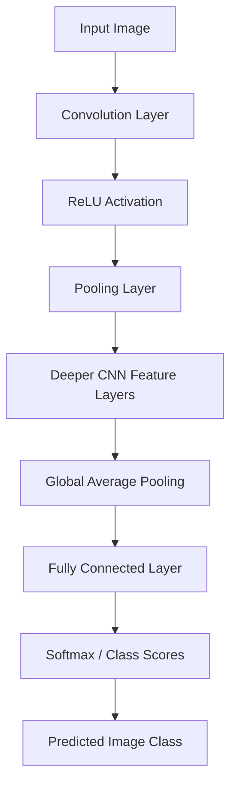

# Task 1 — Understand & Visualize: Convolutional Neural Network (CNN)

## Introduction
A Convolutional Neural Network (CNN) is a deep-learning architecture mainly used to understand images. It learns visual patterns such as edges, shapes, textures and objects. CNNs are widely used in image classification, face detection, medical-image analysis and self-driving systems. Unlike a traditional program that needs manually written rules, a CNN learns useful features from training examples.

## How a CNN works
A CNN receives an image as input. The convolution layer applies small filters (kernels) to find features such as edges and textures. A ReLU activation function adds non-linearity by changing negative values to zero. A pooling layer reduces the feature-map size while retaining important information. Several convolution and pooling stages can learn more complex patterns. The final feature maps are flattened or pooled and passed to fully connected layers. The output layer produces class scores, and softmax converts them into probabilities. The class with the highest probability is selected as the prediction.

## Pretrained model used
This assignment uses ResNet-18, a pretrained CNN available through Torchvision. It has already learned image features from the ImageNet dataset. Transfer learning lets us use this learned knowledge without training a new model from the beginning. The program loads the pretrained weights, applies the required image preprocessing, and predicts the top three ImageNet labels for each input image.

## Experiment
The Python program processes five sample images. If the sample files are not present, run the program with `--download-samples` to download five public example images into the `sample_images` folder. Then run the program normally. For every image, it prints the top three predicted labels and confidence scores. The highest-scoring label is the model's best prediction. Predictions are estimates and may not always be correct, especially when an image contains several objects, unusual lighting or objects outside the model's training classes.

## Conclusion
This experiment demonstrates the basic CNN image-classification workflow: image input, preprocessing, feature extraction and prediction. A pretrained CNN makes it possible to perform useful inference with a short Python program and without training a model from scratch.

## CNN architecture diagram

## Requirements
- Python 3.9 or newer
- PyTorch
- Torchvision
- Pillow

## How to run
1. Open a terminal in this project folder.
2. Install packages: `pip install -r requirements.txt`
3. Download the five sample images: `python cnn_inference.py --download-samples`
4. Run inference: `python cnn_inference.py`

The first run may take time because Torchvision downloads the pretrained ResNet-18 weights. Internet access is required for the sample images and model weights. The program prints results for all five images in the terminal.
